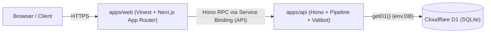

<div align="center">

# CF Turborepo Stack

**Production-ready Cloudflare Workers monorepo combining Vinext (Next.js App Router + React 19), Hono RPC, native Cloudflare D1, Valibot, and Shadcn UI.**

[](https://turbo.build/)
[](https://workers.cloudflare.com/)
[](https://hono.dev/)
[](https://nextjs.org/)
[](https://www.typescriptlang.org/)
[](https://valibot.dev/)

</div>

---

## Architecture

`apps/web` communicates with `apps/api` over Cloudflare's internal network via a **Service Binding** (`API`) and end-to-end typed **Hono RPC** (`hc<AppType>`), eliminating public API round-trips and preserving strict request/response type safety.



---

## Tech Stack

| Layer | Technology |
| :--- | :--- |
| **Monorepo** | Turborepo, `pnpm@9.0.0`, TypeScript 6, Prettier, ESLint 9 |
| **Frontend** | Vinext (`vite`), Next.js App Router, React 19 + React Compiler |
| **UI & Styling** | Tailwind CSS v4, Shadcn UI (`@base-ui/react`), Hugeicons, `@formisch/react` |
| **Backend** | Hono on Cloudflare Workers, `@3lineas/groovepack` (`pipeline`, `logger`, `errors`), `jose` JWT |
| **Database** | Native Cloudflare D1 (`env.DB` via `getD1()`) with raw SQL migrations |
| **Validation** | Valibot (`@hono/valibot-validator`) |
| **Testing** | Vitest + `better-sqlite3` in-memory D1 test harness |

---

## Quick Start

### 1. Scaffold a New Project

```bash
npx @3lineas/create-cf-stack@latest
```

### 2. Install Dependencies & Configure Environment

> [!NOTE]
> Requires **Node.js >= 18** and **pnpm 9**.

```bash
pnpm install
cp apps/api/.dev.vars.example apps/api/.dev.vars
cp apps/web/.env.example apps/web/.env
```

Update `JWT_SECRET` in [apps/api/.dev.vars.example](./apps/api/.dev.vars.example) (copied to `.dev.vars`) with a secure random string of at least 32 characters.

### 3. Initialize Local Database & Start Development

```bash
pnpm db:migrate
pnpm dev
```

---

## Workspace Structure

```text
.
├── apps/
│   ├── api/                 # Hono Worker, atomic Actions, Pipeline orchestration, D1 SQL migrations & Vitest suite
│   └── web/                 # Vinext / Next.js App Router frontend, Server Actions, Shadcn UI & Service Binding client
└── packages/
    ├── eslint-config/       # Shared ESLint 9 flat configurations
    └── typescript-config/   # Shared strict TypeScript base configurations
```

---

## Scripts Reference

### Monorepo Root

| Command | Description |
| :--- | :--- |
| `pnpm dev` | Starts all apps in local development mode (`turbo run dev:vinext`). |
| `pnpm build` | Builds all apps and shared packages for production. |
| `pnpm check-types` | Runs `tsc --noEmit` across the monorepo. |
| `pnpm lint` | Runs ESLint across all workspaces. |
| `pnpm format` | Formats `.ts`, `.tsx`, and `.md` files with Prettier. |

### Database (Cloudflare D1)

| Command | Description |
| :--- | :--- |
| `pnpm db:migrate` | Runs local D1 migrations via `apps/api/scripts/db-migrate.mjs`. |
| `pnpm db:migrate:fresh` | Drops and re-applies all local D1 migrations from scratch. |
| `pnpm db:seed` | Seeds the local D1 database. |
| `pnpm migrate:local` | Applies pending migrations via `wrangler d1 migrations apply DB --local`. |
| `pnpm migrate:remote` | Applies pending migrations to **production** (`--remote`). |

### App-Specific Commands

- **Frontend (`apps/web`)**:
  - `pnpm --filter web dev:vinext` / `pnpm --filter web dev` — Run Vinext (Vite) or Next.js Turbopack dev server.
  - `pnpm --filter web build` / `pnpm --filter web deploy:vinext` — Build and deploy to Cloudflare Workers.
  - `pnpm --filter web cf-typegen` — Regenerate `cloudflare-env.d.ts` from `wrangler.jsonc`.
- **Backend (`apps/api`)**:
  - `pnpm --filter @repo/api dev` / `pnpm --filter @repo/api deploy` — Run local Wrangler dev server or deploy Worker.
  - `pnpm --filter @repo/api test` — Execute the Vitest unit & integration test suite.
  - `pnpm --filter @repo/api cf-typegen` — Regenerate `worker-configuration.d.ts` from `wrangler.toml`.

---

## Adding UI Components

Shadcn UI components live inside `apps/web`. Install new components from the repository root:

```bash
pnpm ui:add button
```

---

## Credits

Built and maintained by **Diego Nelson** for [3 Lineas](https://3lineas.com).
